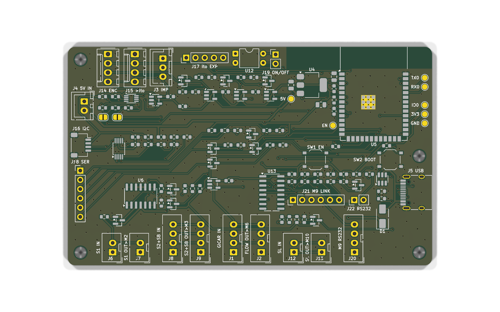

# Unified ESP32 interposer, rev A: schematic

The schematic for [06-014](../../06-014-unified-esp32-interposer-board.md), drawn before George's
measurements M1–M10 came in and updated on 2026-11-08 with the ones he took that day (bench page
Tests 28–37, one per M; cited as **Test n**). The design of record is the
[rev A plan](../../../docs/plans/2026-10-27-unified-esp32-interposer-rev-a-plan.md) (cited as **plan
§n**). The 06-015 flow tap it absorbs is in [`../flow-tap-pcb/`](../flow-tap-pcb/README.md).

**Status (2026-11-08): schematic as data, ERC-clean; draft layout, DRC-clean, not ready to order**
(see [Layout](#layout-draft-2026-11-08) and its
[not ready to order until](#not-ready-to-order-until) list). M1, M6, M7 and M9 are closed; M2 is
closed to "EXCON 2547, probable" (caliper check pending); M3 has its resistance half and George's
front-end decision but no live node voltages; M10 has the mount sites but no cable lengths. Nothing
here is a guess. Every value that waits on a measurement is listed in
[Placeholders](#placeholders-what-closes-each-one), and every part number comes from a datasheet or
a JLCPCB part page read on 2026-10-28 (no new LCSC numbers were added on 2026-11-08).

| File                                                 | What it is                                                                                                   |
| ---------------------------------------------------- | ------------------------------------------------------------------------------------------------------------ |
| [`circuit.py`](circuit.py)                           | **Single source of truth.** Parts, nets, NC pads, GPIO map, placeholders. Importable by a future generator.  |
| [`check_circuit.py`](check_circuit.py)               | ERC-style checker (11 checks). Exit 0 = pass.                                                                |
| [`footprints/`](footprints/)                         | The 26 footprints `circuit.py` names (24 KiCad 9 library, 2 EXCON authored) + 2 layout-only (hole, test pad) |
| [`gen_excon_footprints.py`](gen_excon_footprints.py) | Writes `EXCON_2547-02_WV` / `-04_WV` from EXCON drawing C2547WV rev E. Plain Python.                         |
| [`generate_pcb.py`](generate_pcb.py)                 | Layout generator (KiCad 9 `pcbnew` API): reads `circuit.py`, writes the board, BOM and CPL.                  |
| `interposer-rev-a.kicad_*`, `fp-lib-table`           | The generated KiCad project (board, netclasses, custom DRC rule, library table pointing at `footprints/`).   |
| [`routing/`](routing/)                               | The Freerouting session the board is built from (committed, so regeneration doesn't need the router).        |
| [`fab/`](fab/)                                       | Gerber + drill zip, JLC BOM + CPL, assembly drawing (PDF), top/bottom renders, DRC report.                   |

```sh
cd 06-coffee-espresso/_reference/interposer-rev-a
python3 circuit.py              # part / net summary per function block
python3 check_circuit.py -v     # ERC; -v also prints the GPIO map
```

Output today: `116 parts (74 fitted, 42 DNP), 86 nets` and `ALL 11 CHECKS PASS`. Plain Python 3, no
dependencies. The checker reads pad names straight out of the vendored `.kicad_mod` files, so a typo
in a pin number fails C1.

**No KiCad schematic (`.kicad_sch`) in this rev.** kiutils can write one, but every one of the 105
parts would need a library symbol placed and wired or labelled by hand-written coordinates, and
`kicad-cli` has no headless netlist import to validate a `.net` file against. That is hours for a
drawing that adds nothing `circuit.py` + the checker don't already enforce. The layout generator
should read `circuit.py` directly (as 06-015's `generate_pcb.py` hard-codes its nets today), and DRC
on the generated board is the KiCad-side validation.

## What the checker enforces

| #   | Rule                                                                                                                                                                                           | Source                      |
| --- | ---------------------------------------------------------------------------------------------------------------------------------------------------------------------------------------------- | --------------------------- |
| C1  | Every part has a vendored footprint; every `REF.pad` named exists in it                                                                                                                        | KiCad 9 library             |
| C2  | Every footprint pad is on a net or listed in `NC` with a reason                                                                                                                                | —                           |
| C3  | Every net ≥ 2 pins; no pin on two nets                                                                                                                                                         | —                           |
| C4  | GICAR meter supply (`N_PLUS`; ~3.3 V measured, Test 36) touches only `J1.2` / `J2.2`                                                                                                           | 06-015, plan §3.4           |
| C5  | ito 5 V (`V5_ITO`, `ITO_EXP_5V`) never meets `+3V3` / `+5V` / `VBUS`, directly or through any R, C, D, jumper or switch; U1 on ito 5 V, U2 on 3V3                                              | plan §3.4                   |
| C6  | Each GPIO used once and matches the GPIO table; no strapping, octal-PSRAM, UART0 or non-existent pin; USB only on GPIO19/20; analog nets on ADC1                                               | ESP32-S3-WROOM-1 DS v1.8    |
| C7  | `SB` / `SL` probe lines touch only the pass-through connectors and the series coupling cap; the aux pins are pure pass-through                                                                 | plan §3.3                   |
| C8  | `S1` / `S2` feeds touch only the pass-through connectors and one series R into a follower; the follower input has only a BAV99 to +5V / GND; the divider holds the ADS input under VDD + 0.3 V | plan §3.2, SBAS444E         |
| C9  | `ENC` lines touch only connectors, FET drains (source on GND, gate pulled down) and LVC inputs: pull-low only, never driven high. J14.1 NC, J15.1 GND                                          | plan §3.5, Test 33          |
| C10 | IC power pins on the intended rails                                                                                                                                                            | each datasheet's pin table  |
| C11 | M9 tap: U13's line pins, its RX output and the passive path reach M9 / GPIO38 only through DNP links; DIN1 has its pull-up                                                                     | George 2026-11-08, SLLS410O |

The checker was mutation-tested: putting a part on `N_PLUS`, a resistor on `SB_PROBE`, a pull-up on
`ENC_A`, GPIO3 on a signal, or `R39` from `V5_ITO` to 3V3 each fails the right check. On 2026-11-08:
a part on `S1_FEED`, a clamp off its rail, and a GND on `J14.1` each fail too.

## Blocks

Pass-through copper is drawn `═══`. Every machine signal goes in on one connector and straight out
on its mate. Only `ENC` can pull low (plan §2 design invariant).

### F0 power, ESP32, USB

```text
 J4 XH-2 (5V in, our choice: 1 = +5V, 2 = GND) ──────────────┬── +5V ──┬── U6 VDD (NTC followers)
                                                             │         │
 J5 USB-C ── VBUS ──►|── D1 SS34 (VBUS → +5V only) ──────────┘   C3 10µ│
   CC1 ── R1 5k1 ── GND     CC2 ── R2 5k1 ── GND                       │
   D+ (A6,B6) ══ U3 USBLC6-2SC6 (1/6) ══ GPIO20                 U4 AMS1117-3.3 (VIN 3, GND 1, VOUT 2/tab)
   D- (A7,B7) ══ U3 (3/4) ═════════════ GPIO19                         │
   U3.5 VBUS, U3.2 GND                                         +3V3 ──┴── C4 22µ ── U5.2 3V3 (C5 22µ + C6 100n at pin)
 U5 ESP32-S3-WROOM-1-N8:  EN ── R3 10k ── 3V3, C7 1µ ── GND, SW1 ── GND   (DS v1.8 §9: R = 10k, C = 1µF)
                          GPIO0 ── R4 10k ── 3V3, SW2 (BOOT) ── GND
```

- **Never plug USB in while the machine is plugged in** (plan §3.1). D1 only stops the 5 V PSU
  back-feeding a USB host. It is not isolation.
- **The board's GND is chassis earth once installed.** The control board's GND is isolated from
  mains (Test 28: GND to N and to F open unplugged; GND to PE 2 mV AC, 0 V DC powered; PS1 is a
  Lauma SMR30.10, Class II), but it is bonded to the chassis through M3 pin 4, the steam-level
  return to the boiler body (Test 30: GND to the earth screw beeps with M3 plugged in, not with it
  out). So flash an installed board from a grounded or battery-powered laptop.
- **USB headroom:** AMS1117 dropout is 1.3 V max at 0.8 A, so it wants ≥ 4.6 V in. USB through D1
  can sit just under that. Flashing works; Wi-Fi TX peaks on USB power may brown out. Use J4 for
  bench tests T2+.

### F1 / F2 `S1` / `S2` NTC taps (one follower per feed)

The control board's sensor headers (Test 29, George's trace on his v.05.01 board): **M2** 2-pin =
steam NTC (`S1`), 1 GND, 2 feed. **M3** 4-pin = 1 GND, 2 group NTC feed (`S2`), 3 steam-boiler level
probe (`SB`), 4 GND (the level return, wired to the boiler body). So `S2` and `SB` share one plug,
and J8/J9 carry both.

```text
 J6.2 (S1 steam probe) ═══════ S1_FEED ═══════ J7.2 (→ control board M2.2)
 J6.1 / J7.1 = GND (Test 30: 0.2 Ω to M6 pin 3)  ── tied to the board GND
                                │
                               R5 1M                       (George 2026-11-08: "1 MΩ series")
                                │  S1_IN ── D2 BAV99 to +5V / GND
                       U6A MCP6004 follower (IN+ 3, IN- 2 = OUT 1), VDD = +5V
                                │  S1_BUF
                               R9 10k ── S1_ADC ── R13 5.1k ── GND, C9 100n ── GND
                                │
                           U7 ADS1115 AIN0          S2: J8.2/J9.2, R6, D3, U6B, R10/R14, C10 → AIN1
 U7: VDD 3V3 (C13 100n), ADDR = GND → 0x48, AIN2/AIN3 = GND (unused), ALERT/RDY → R21 10k ── 3V3, GPIO10
 U6C / U6D unused: OUT tied to IN-, IN+ at GND
```

- **George's decisions (2026-11-08).** First: "Measure 0–5.5 V, survive 24 V", a high-impedance
  buffered input with series R plus clamp diodes so up to ~24 V can't damage it, without loading the
  probe (the control board must read the same temperature). Then, answering the two questions this
  raised: **"1 MΩ series"** and **"Accept 0–5.0 V"**.
- **Only the feed is buffered.** Test 30 found pin 1 of each probe header at GND (0.2 Ω) and pin 2
  the feed, so the second follower per probe that rev A drew "in case the GND pin is the other one"
  is gone, and the NTC GND pins join the board GND.
- **Range: 0 to ~5.0 V.** U6 stays on +5V. The MCP6004 is rail-to-rail: its input range ends at
  VDD + 0.3 V and its output at VDD − 25 mV (DS20001733L), so it reads 0 to ~5.0 V. That covers the
  1.5–4.7 V estimate below. Revisit in rev B if the live measurement shows the node near 5 V.
- **Divider after the follower, unchanged.** R9/R13 = 10k/5.1k = 0.338: 5.0 V at the node is 1.69 V
  at the ADS, 83 % of the ±2.048 V FSR, ~185 µV per code at the node. A closer ratio would need a
  new resistor value for less than one bit, so it stays. The follower output can't exceed +5V, so
  the ADS pin stays under VDD + 0.3 V (SBAS444E abs max; checker C8). The divider loads the op-amp,
  never the node.
- **Series R = 1 MΩ.** A 24 V fault pushes (24 − 5.3) V / 1 MΩ = 19 µA into D2 and the op-amp input
  diodes, against the MCP6004's ±2 mA input-pin rating (checker C8 recomputes this). With the
  interposer **unpowered** and the machine on, the feed reaches the dead +5V rail through 1 MΩ and
  the clamp: with the 5 V / 15 kΩ model at 94 °C that is ~1.7 µA, ~12 mV at the group node, about
  0.3 °C at the control board (100 kΩ would have been ~3 °C). **Test T4 runs with the interposer
  powered and unpowered.**
- **D2/D3 fitted, with a cost to watch.** BAV99 leakage is ≤ 25 nA at 20 V (Diodes ds12007). Through
  1 MΩ that is ≤ 25 mV worst case at the follower (~0.6 °C at 94 °C), and ≤ 0.4 mV at the node
  through the ~15 kΩ feed, so it costs reading accuracy, not control-board accuracy. If T3 shows it
  matters, D2/D3 can go DNP: the op-amp's own input diodes and 1 MΩ still hold a 24 V fault to 19
  µA.
- **Node estimate (Test 30, not yet measured live):** feed pin to GND reads 15 kΩ (M3) and 16.5 kΩ
  (M2) on the unpowered board, so assuming 5 V through ~15 kΩ: group ~4.7 V cold and ~2.4 V at 94
  °C, steam ~4.6 V cold and ~1.5 V at 6.8 kΩ. The live check waits for an EXCON extension lead.
- **Curves (firmware, Test 30):** group 249 kΩ at 21 °C and 13.3 kΩ at 94 °C, so β ≈ 4340 K, R25 ≈
  205 kΩ. Steam 201.7 kΩ at 21 °C and 6.8 kΩ hot at an unknown temperature: it needs a second known
  point.

### F3 / F4 `SB` / `SL` level taps (pass-through + DNP AC front-end)

```text
 J8.3 (SB probe, M3 pin 3) ═════ SB_PROBE ═════ J9.3     J8.4 ═════ SB_AUX (level return) ═════ J9.4
                           │                                (pure pass-through: not tied to our GND)
                        C14 (DNP, series coupling C; value + voltage TBD at M4)
                           │  SB_AC
                        R22 100k (DNP)
                           │  SB_FE ── R24 1M ── 3V3, R26 1M ── GND (DNP mid-rail bias)
                           │         D6 BAV99 (DNP) to 3V3 / GND
                         GPIO1 (ADC1_CH0)          SL: J12/J13 (M10), C15, R23, R25, R27, D7 → GPIO2 (ADC1_CH1)
```

- The probe line touches **only** the connectors and C14 (checker C7). The bias sits on our side of
  the capacitor, so no DC ever reaches the probe (plan §3.3).
- The level return (M3 pin 4) is GND on the control board (0.9 Ω, Test 30) and runs to the boiler
  body. It is kept pure pass-through here so the probe's current never runs through our ground
  plane.
- Firmware samples the AC amplitude on ADC1. ADC1 is used because ADC2 can't run alongside Wi-Fi
  (ESP32-S3 Series DS v2.2).
- Everything after the connectors is DNP until M4/M5 (Tests 31/32 not done). `SL` is M10, a 2-pin
  EXCON header (Test 29); which pin is signal and which is return is unknown, so pin 1 is drawn as
  the tapped line and pin 2 is passed through and touches nothing else.

### F5 flow: 06-015 circuit + ESP32 buffer

```text
 J1 GICAR (EXCON 2547-4)                           J2 to control board M6 (EXCON 2547-4)
   1 key-blank                                       1 key-blank
   2 + ~3.3V ══════════ N_PLUS ═══════════════════   2     (J1.2 ↔ J2.2 ONLY; checker C4)
   3 GND    ═══════════ GND ══════════════════════   3
   4 o      ═══════════ N_O ══════════════════════   4
                         ├── U1 74LVC1G17 @ ito 5V (VCC 5 = J3.3 V5_ITO, C1 100n) ── Y 4 ── J3.2 → ito IMPULSE
                         └── U2 74LVC1G17 @ 3V3 (C2 100n) ── Y 4 ── FLOW_3V3 ── GPIO11 (pulse_counter)
 J3 to ito (XH-3): 1 GND, 2 OUT, 3 +5V (ito's)
```

- J3/U1/C1 and the net names are 06-015's, unchanged. **J1/J2 change family:** M6 is the same black
  EXCON 2547 header as the sensor headers (Test 29), not JST XH, so the 06-015 XH pair does not mate
  with this machine.
- **The meter supply is ~3.3 V here, not 14.3 V** (Test 36, meter unplugged: P2→P3 3.3 V, P4→P3 4.9
  V, P2→P4 1.62 V; P2 red, P3 black, P4 white, P1 the blank key). The 14.3 V figure came from a
  forum thread, never this machine. Everything on M6 is ≤ 5 V. The pass-through-only rule (checker
  C4) stays: it is the meter's own supply. The loaded supply voltage (meter connected) waits for an
  EXCON extension lead.
- **The plan's "confirm at layout" is closed:** SN74LVC1G17 input range is 0–5.5 V at any VCC
  (SCES351Y, recommended operating conditions), so U2 takes the 4.9 V `o` while powered from 3.3 V.
  Ioff keeps both buffers from loading `o` when their supply is off.
- ito's 5 V (`V5_ITO`) and our `+3V3` / `+5V` share only GND (checker C5).

### F6 ito `ENC` interposer (3 lines: SW, A, B)

```text
 J14 KK-4 (encoder cable)  1 empty (NC)          1 GND ═══ J15 KK-4 (to ito ENC)
                           2 SW  ═══ ENC_SW ═══ 2 ── Q3 drain │ U10 A
                           3 A   ═══ ENC_A ════ 3 ── Q1 drain │ U8 A
                           4 B   ═══ ENC_B ════ 4 ── Q2 drain │ U9 A
 inject:  GPIO4/5/6 ── R28-30 1k ── gate Q1-3 AO3400A (source GND) ; gate ── R31-33 100k ── GND
 read:    U8/U9/U10 74LVC1G17 @ 3V3 (C16-18 100n), Y → GPIO7 / GPIO15 / GPIO16
```

- **Three lines.** The encoder sits on the display board (V1.3), and its cable carries only SW / A /
  B in holes 2 / 3 / 4; hole 1 is empty, because the display board gets GND over the SPI cable (Test
  33). Each line passes a 4.7 kΩ series resistor on the display board (R1–R3, with C5–C7 on the
  encoder side). ito's ENC pin 1 is GND, so J15.1 carries our GND to ito as the FETs' return, and
  J14.1 is NC (checker C9). The order matches the ito manual (p.63) and the KK 254 2.54 mm family
  (Test 33: ~7.7 mm across 4 pins).
- **Idle high, pull-low only** (Test 34, in the machine): SW, A and B rest at 5.05 V (ito pull-ups),
  A and B are open at the detents tried, SW pressed reads 0 V. Nothing needs masking at rest.
  Pulling a line low on the ito side drives the ito input directly and sees the encoder's caps only
  through 4.7 kΩ.
- **Pull-low only:** the FET can only short a line to GND, like a detent closing, and nothing ever
  drives a line high (checker C9). The 100 kΩ gate pull-downs hold every FET off while the ESP32 is
  unpowered, in reset, or booting, so the knob behaves stock.
- AO3400A: Vgs(th) 0.65–1.45 V, Rds(on) < 48 mΩ at Vgs 2.5 V (AOS DS rev 3.1), so a 3.3 V GPIO turns
  it fully on. Pinout 1 G, 2 S, 3 D. It is a JLC basic part, so no loading fee. The plan's other
  option, a 74LVC1G07, idles low with its input low, which would inject at boot.
- Read-back is a 5 V-tolerant LVC Schmitt input (II ±5 µA max), not a divider, so it adds no DC load
  to ito's pull-ups.

### F7 shared I²C

```text
 GPIO8 SDA / GPIO9 SCL ── R34 / R35 4.7k ── 3V3
   ├── U7 ADS1115 (0x48)
   ├── J16 Qwiic JST-SH 4-pin: 1 GND, 2 3V3, 3 SDA, 4 SCL (sparkfun.com/qwiic)
   └── U11 PCA9306 (DNP): VREF1 = 3V3, SCL1/SDA1 = bus; VREF2 = EN ── R36 200k (DNP) ── ito 5V
         SDA2 ── JP2 (open) ── J17.5 EXP SDA      SCL2 ── JP3 (open) ── J17.4 EXP SCK
         R37 / R38 4.7k (DNP) SDA2/SCL2 ── ito 5V       J17 (DNP): 1 +5V(ito), 2 GND, 3 NC, 4 SCK, 5 SDA
```

- PCA9306 hookup per SCPS113O §8.1.2 (EN tied to VREF2, 200 kΩ to the high-side supply). VREF1 ≤
  VREF2 − 0.6 V is satisfied by 3.3 V / 5 V.
- JP2/JP3 open and U11 unfitted mean the ito `EXPANSION` bus is isolated by default. There is no
  multi-master in rev A (plan §3.6).

### F8 `SER` stub (all DNP)

```text
 J18 (1x6 0.1"): 1 GND, 2 SER_3V3_H ── R39 0R ── 3V3,
   3 SER_TX_H ── R40 ── SER_TX ── GPIO17 (U1TXD)     each MCU-side net also has a DNP divider-bottom
   4 SER_RX_H ── R41 ── SER_RX ── GPIO18 (U1RXD)     R (R44-R47) to GND and a DNP BAV99 clamp
   5 SER_IO1_H ── R42 ── SER_IO1 ── GPIO13            (D8-D11) to 3V3 / GND
   6 SER_IO2_H ── R43 ── SER_IO2 ── GPIO14
```

Values are TBD until the M8 / Saleae capture. Nothing is inserted into the touchpad link (plan
§3.7).

### F8b control-board M9 "RS232 serial" tap

M9 is a 4-pin EXCON header on the control board with nothing plugged in. The case sticker labels it
"RS232 serial / Seriale 232" (Test 29). Its pin roles and levels are unknown: **scope before
connecting.** Two paths to UART2 are drawn; **every connection from either path to M9 is an open DNP
link**, so nothing touches the machine until M9 is scoped and one path is chosen.

```text
 J20 EXCON 2547-4 (DNP, cable to M9) pins 1..4 ══ M9_P1..P4 ══ J21 (1x6 0.1", DNP) pins 1..4

 transceiver path (U13 fitted, links DNP):
   GPIO21 (UART2 TX) ── M9_TX ── U13 DIN1 (11)      R55 10k ── 3V3 (pull-up, fitted)
   U13 DOUT1 (14) ── R52 0R (DNP) ── J22.1 ;  J22.2 ── R53 0R (DNP) ── U13 RIN1 (13)
   U13 ROUT1 (12) ── R54 0R (DNP) ── M9_RX ── GPIO38 (UART2 RX)
   U13 MAX3232 @ 3V3: C19 C1+/C1-, C20 C2+/C2-, C21 V+→GND, C22 GND→V-, C23 VCC bypass (all 0.1 µF)
   channel 2: DIN2 (10) = GND, DOUT2 / RIN2 / ROUT2 unconnected

 passive path (all DNP):
   GPIO21 ── R49 (TBD) ── M9_TX_H ── J21.5
   GPIO38 ── M9_RX ── R50 (TBD) ── M9_RX_H ── J21.6 ;  M9_RX: R51 (TBD) ── GND, D12 BAV99 to 3V3 / GND
```

- **George 2026-11-08:** "Add a DNP transceiver footprint", then "why wouldn't we place the
  transceiver if it's cheap?". So U13 and its caps are **fitted**, and only the links are DNP.
- **Why the links stay open:** the MAX3232's driver swings about ±5.4 V (VOH/VOL at 3 kΩ, TI
  SLLS410O §6.6). If M9 is 5 V logic into the control board's MCU, that could damage the machine.
  Scope M9 first, then fit **one** path: R52 + R53 + R54 for the transceiver, or R49–R51 + D12 for
  logic levels, plus two wire links from the M9 pins on J21.1–4 to J22.1/.2 or J21.5/.6. Checker C11
  fails if any part on those nets is fitted.
- **RS-232 is inverted vs TTL** (a mark is the negative level). The MAX3232 inverts back; on the
  passive path, the ESP32 UART can invert in software if M9 turns out to be inverted logic.
- **Nothing on the ESP32 side can back-drive the machine with the links open.** GPIO21 drives only
  U13 DIN1 (a logic input, ±1 µA, SLLS410O §6.6) and the open R49. U13's line outputs end at open
  R52/R53. GPIO38 sees nothing until R54 or R50 is fitted.
- **One pull-up, one not.** DIN1 gets R55 10k to 3V3 (fitted): the datasheet says every DIN must sit
  at a valid low or high (§8.3.2, §9.2.2) and DIN has no internal pull (input current ±1 µA), while
  GPIO21 is unconfigured at boot. High is UART idle (mark). GPIO38 gets no external resistor:
  floating, it is an unconfigured ESP32 input that drives nothing, and once a path is fitted it is
  driven (ROUT1 is push-pull; an open RIN reads as a high ROUT, §8.3.3). Firmware can enable the
  internal pull-up.
- **U13:** TI MAX3232EIDR, SOIC-16, LCSC C193666 (JLC extended, read 2026-11-08), 3–5.5 V, 250
  kbit/s, ±15 kV ESD on the line pins. Caps 0.1 µF each at VCC 3.3 V (Table 9-1); C3 may go to VCC
  or GND (Fig 9-1); the 50 V 0603 X7R part covers V+/V− (≤ 7 V abs max).
- UART2 reaches GPIO21/38 through the GPIO matrix. Both were spare.

### F9 on/off dry contact (all DNP)

```text
 GPIO12 ── R48 330 (DNP) ── U12 TLP222A pin 1 (LED A), pin 2 (LED K) ── GND
 U12 pins 4 / 3 (contact) ── J19 pins 1 / 2 (to the panel ON/OFF pair, if M8 finds one)
```

The TLP222A datasheet could not be retrieved, so the pinout and the LED resistor are **unverified**.
Check both against the datasheet before fitting.

## GPIO allocation

ESP32-S3-WROOM-1 module pins from datasheet v1.8 Table 3-1. Checker C6 enforces every row.

| GPIO | Module pin | Net          | Use                                  |
| ---- | ---------- | ------------ | ------------------------------------ |
| 0    | 27         | `BOOT`       | strapping (boot mode): SW2 + R4 only |
| 1    | 39         | `SB_FE`      | ADC1_CH0, SB level (DNP until M4)    |
| 2    | 38         | `SL_FE`      | ADC1_CH1, SL level (DNP until M5)    |
| 4    | 4          | `ENC_INJ_A`  | Q1 gate (pull `ENC_A` low)           |
| 5    | 5          | `ENC_INJ_B`  | Q2 gate                              |
| 6    | 6          | `ENC_INJ_SW` | Q3 gate                              |
| 7    | 7          | `ENC_RD_A`   | U8 read-back                         |
| 8    | 12         | `I2C_SDA`    | ADS1115, Qwiic, (PCA9306)            |
| 9    | 17         | `I2C_SCL`    |                                      |
| 10   | 18         | `ADS_ALERT`  | ADS1115 ALERT/RDY                    |
| 11   | 19         | `FLOW_3V3`   | flow `pulse_counter` (U2)            |
| 12   | 20         | `ONOFF_DRV`  | F9 photorelay LED (DNP)              |
| 13   | 21         | `SER_IO1`    | F8 spare (DNP)                       |
| 14   | 22         | `SER_IO2`    | F8 spare (DNP)                       |
| 15   | 8          | `ENC_RD_B`   | U9 read-back                         |
| 16   | 9          | `ENC_RD_SW`  | U10 read-back                        |
| 17   | 10         | `SER_TX`     | U1TXD, F8 (DNP)                      |
| 18   | 11         | `SER_RX`     | U1RXD, F8 (DNP)                      |
| 19   | 13         | `USB_DN`     | USB D- (fixed)                       |
| 20   | 14         | `USB_DP`     | USB D+ (fixed)                       |
| 21   | 23         | `M9_TX`      | UART2 TX → U13 DIN1 (R55 pull-up)    |
| 38   | 31         | `M9_RX`      | UART2 RX ← R54 or R50 (DNP links)    |

Deliberately unused: GPIO3, 45, 46 (strapping, left at their datasheet defaults, Table 4-1);
GPIO35–37 (octal PSRAM on R8 modules, Table 3-1 note b, kept free so a module swap is safe);
GPIO43/44 (UART0 ROM console; add test pads at layout); GPIO39–42 (JTAG, spare); GPIO47, 48 (spare).
GPIO26–34 are not module pins.

## Power budget

| Load                       | Rail   | Current                         | Source                   |
| -------------------------- | ------ | ------------------------------- | ------------------------ |
| ESP32-S3-WROOM-1 Wi-Fi TX  | 3V3    | 355 mA peak (802.11b, 20.5 dBm) | module DS v1.8 Table 6-4 |
| ESP32 supply requirement   | 3V3    | **≥ 0.5 A** must be available   | module DS v1.8 Table 6-2 |
| ADS1115                    | 3V3    | 0.2 mA max (25 °C), 0.3 mA max  | SBAS444E §5.5            |
| MCP6004 (4 amps)           | 5V     | 4 × 170 µA max = 0.68 mA        | DS20001733L              |
| S1/S2 dividers (15.1 kΩ)   | 5V     | ≤ 2 × 0.33 mA (via U6)          | Ohm's law                |
| 74LVC1G17 × 4 (U2, U8–U10) | 3V3    | 4 × 10 µA max                   | SCES351Y ICC             |
| I²C pull-ups (both low)    | 3V3    | 2 × 0.7 mA                      | Ohm's law, 4.7 kΩ        |
| AMS1117 quiescent          | 5V     | 11 mA max                       | AMS1117 DS               |
| U1 74LVC1G17 (ito domain)  | ito 5V | 10 µA max (from ito, as 06-015) | SCES351Y                 |

- **Design point:** 3V3 at 0.5 A (the module's own requirement dominates; everything else is < 5
  mA). 5 V input ≥ 0.52 A (about 2.6 W). Spec the off-board PSU for ≥ 1 A at 5 V. ito's own HLK-PM01
  is only documented as "5 V ≥ 600 mA" (ito manual p.70), which leaves thin margin. A dedicated
  module or a 1 A+ USB brick is the safer choice.
- **LDO heat:** (5.0 − 3.3) V × 0.355 A = 0.60 W at the TX peak. SOT-223 θJA is 90 °C/W (AMS DS), so
  a sustained peak would be a 54 °C rise. TX is bursty, so the average is far lower. Give the tab a
  copper pour at layout anyway, and measure the rail during T2.

## BoM

From `circuit.py` (it is the source; regenerate rather than hand-edit). Library class is as read on
each **jlcpcb.com/partdetail** page on 2026-10-28. **Stock is unchecked for every part**: the page
text we could read shows no stock figure. Check all of it on order day (plan §6). "unstated" means
the page showed no clear Basic/Extended label.

| Refs                        | Value                       | MPN                       | LCSC     | JLC class   | Fit |
| --------------------------- | --------------------------- | ------------------------- | -------- | ----------- | --- |
| U5                          | ESP32-S3-WROOM-1-N8         | Espressif                 | C2913198 | extended    | fit |
| U4                          | AMS1117-3.3, 1 A            | AMS1117-3.3               | C6186    | basic       | fit |
| U6                          | MCP6004 quad op-amp         | MCP6004T-I/SL (Microchip) | C7378    | extended    | fit |
| U7                          | ADS1115                     | ADS1115IDGSR (TI)         | C37593   | extended    | fit |
| U1 U2 U8 U9 U10             | 74LVC1G17                   | SN74LVC1G17DBVR (TI)      | C7836    | extended    | fit |
| Q1 Q2 Q3                    | AO3400A N-FET               | AO3400A (AOS)             | C20917   | basic       | fit |
| U3                          | USB ESD                     | USBLC6-2SC6 (ST)          | C7519    | extended    | fit |
| J5                          | USB-C 16P                   | TYPE-C-31-M-12 (HRO)      | C165948  | extended    | fit |
| D1                          | Schottky 3 A 40 V           | SS34 (MDD)                | C8678    | unstated    | fit |
| D2 D3                       | BAV99                       | BAV99,215 (Nexperia)      | C2500    | unstated    | fit |
| J16                         | JST-SH 4-pin (Qwiic)        | SM04B-SRSS-TB(LF)(SN)     | C160404  | extended    | fit |
| SW1 SW2                     | tactile 5.1 mm              | TS-1187A-B-A-B (XKB)      | C318884  | unstated    | fit |
| C1 C2 C6 C8–C10 C13 C16–C18 | 100 nF 50 V X7R 0603        | CC0603KRX7R9BB104         | C14663   | basic       | fit |
| C7                          | 1 µF 0603                   | CL10A105KB8NNNC           | C15849   | basic       | fit |
| C3                          | 10 µF 0805                  | CL21A106KAYNNNE           | C15850   | basic       | fit |
| C4 C5                       | 22 µF 0805                  | CL21A226MAQNNNE           | C45783   | unstated    | fit |
| R28–R30                     | 1 kΩ                        | 0603WAF1001T5E            | C21190   | basic       | fit |
| R34 R35                     | 4.7 kΩ                      | 0603WAF4701T5E            | C23162   | basic       | fit |
| R1 R2 R13 R14               | 5.1 kΩ                      | 0603WAF5101T5E            | C23186   | basic       | fit |
| R3 R4 R9 R10 R21            | 10 kΩ                       | 0603WAF1002T5E            | C25804   | basic       | fit |
| R31–R33                     | 100 kΩ                      | 0603WAF1003T5E            | C25803   | basic       | fit |
| R5 R6                       | 1 MΩ                        | 0603WAF1004T5E            | C22935   | basic       | fit |
| U13                         | MAX3232 RS-232              | MAX3232EIDR (TI)          | C193666  | extended    | fit |
| C19–C23                     | 100 nF 50 V X7R 0603        | CC0603KRX7R9BB104         | C14663   | basic       | fit |
| R55                         | 10 kΩ                       | 0603WAF1002T5E            | C25804   | basic       | fit |
| R52–R54                     | 0 Ω (links)                 | 0603WAF0000T5E            | C21189   | basic       | DNP |
| D6–D12                      | BAV99                       | BAV99,215 (Nexperia)      | C2500    | unstated    | DNP |
| U11                         | PCA9306                     | PCA9306DCUR (TI)          | C33196   | extended    | DNP |
| U12                         | TLP222A photorelay          | TLP222A(TP1,F) (Toshiba)  | C2152279 | extended    | DNP |
| C14 C15                     | 100 nF (TBD at M4/5)        | CC0603KRX7R9BB104         | C14663   | basic       | DNP |
| R22 R23                     | 100 kΩ                      | 0603WAF1003T5E            | C25803   | basic       | DNP |
| R24–R27                     | 1 MΩ                        | 0603WAF1004T5E            | C22935   | basic       | DNP |
| R36                         | 200 kΩ                      | 0603WAF2003T5E            | C25811   | basic       | DNP |
| R37 R38                     | 4.7 kΩ                      | 0603WAF4701T5E            | C23162   | basic       | DNP |
| R39                         | 0 Ω                         | 0603WAF0000T5E            | C21189   | basic       | DNP |
| R48                         | 330 Ω (TBD)                 | 0603WAF3300T5E            | C23138   | basic       | DNP |
| R40–R47 R49–R51             | TBD                         | —                         | —        | —           | DNP |
| J1 J2 J8 J9                 | EXCON 2547 4-pin            | 254704WV203 (probable)    | —        | hand-solder | fit |
| J6 J7 J12 J13               | EXCON 2547 2-pin            | 254702WV203 (probable)    | —        | hand-solder | fit |
| J20                         | EXCON 2547 4-pin            | 254704WV203 (probable)    | —        | hand-solder | DNP |
| J3 / J4                     | JST XH 3 / 2-pin            | B3B / B2B-XH-A            | —        | hand-solder | fit |
| J14 J15                     | Molex KK 254 4-pin          | 22-27-2041                | —        | hand-solder | fit |
| J17 J18 J21 J19 J22         | 1x5 / 1x6 / 1x6 / 1x2 / 1x2 | 2.54 mm header            | —        | hand-solder | DNP |
| JP2, JP3 (open)             | solder jumpers              | copper                    | —        | —           | —   |

**EXCON jumper cables** (one per interposed header, board to control board, plus one for M9 if
fitted): housings 254702HA203 / 254704HA203, terminals 254700TC351 (tin) or 254700TC501 (gold), AWG
26–22 (EXCON 2547HA / 2547TC drawings). Lengths wait on M10. Whether the machine's terminals are tin
or gold is not recorded; match them.

Fitted extended parts (one JLC loading fee each): U5, U6, U7, 74LVC1G17, U3, J5, J16, plus D1, SW
and C4/C5 if their "unstated" class turns out to be extended.

## Placeholders: what closes each one

Closed on 2026-11-08 (George, bench page): **M1** Test 28 (GND isolated from mains; earth-bonded via
M3 pin 4, Test 30), **M6** Test 33 (KK 254, SW/A/B, hole 1 empty, ito pin 1 GND), **M7** Test 34
(idle 5.05 V, A/B open at detents), **M9** Test 36 (meter supply ~3.3 V, `o` 4.9 V).

| Closes     | Refs                                | Placeholder today                                                                                                                                  |
| ---------- | ----------------------------------- | -------------------------------------------------------------------------------------------------------------------------------------------------- |
| **M2**     | J1 J2 J6 J7 J8 J9 J12 J13 J20       | EXCON 2547 is probable (Test 29), not caliper-confirmed: check the 4-pin header is ~12.7 mm wide before ordering housings or boards.               |
| **M3**     | R5 R6 D2 D3 U6 VDD                  | Live node voltages not measured (needs an EXCON extension lead). Range 0 to ~5.0 V ("Accept 0–5.0 V"); revisit in rev B if the node sits near 5 V. |
| **M3**     | R5 R6 D2 D3                         | 1 MΩ ("1 MΩ series"). T4 runs with the interposer powered **and** unpowered. D2/D3 to DNP if T3 shows their leakage matters.                       |
| **M3**     | firmware                            | Steam NTC: 201.7 kΩ at 21 °C, 6.8 kΩ hot at an unknown temperature. Needs a second known point.                                                    |
| **M4**     | C14, R22, R24, R26, D6              | `SB` method + excitation (Test 31 not done). On J8/J9 pin 3; front-end DNP; C14 value/rating TBD.                                                  |
| **M5**     | J12, J13, C15, R23, R25, R27, D7    | `SL` (M10) method and which pin is signal vs return (Test 32 not done). Front-end DNP.                                                             |
| **M8**     | J18, R39–R47, D8–D11, U12, R48, J19 | 16-way ribbon on M1 seen (Test 35, partial); panel end and the ON/OFF pair not reached. All DNP; values TBD.                                       |
| **M9 tap** | J20–J22, R49–R54, D12               | M9 "RS232 serial" pin roles and levels unknown. Scope, then fit ONE path: links R52–R54 (U13) or R49–R51 + D12 (values TBD).                       |
| **M10**    | outline, jumper cables              | Sites measured (Test 37), cable lengths not. See below.                                                                                            |
| DS         | U12, R48                            | TLP222A datasheet not retrieved: pinout and LED current unverified.                                                                                |
| DS         | J17                                 | ito `EXPANSION` pad pitch/form not measured: drawn as a 2.54 mm 1x5 header.                                                                        |
| DS         | U3                                  | USBLC6-2SC6 pinout taken from the KiCad library symbol; the ST datasheet would not download.                                                       |
| DS         | U11                                 | KiCad `VSSOP-8_2.3x2mm` land vs TI DCU land pattern: compare at layout (DNP part).                                                                 |

**M10 mount sites** (Test 37, George): in the control-board box beside M6, 55 × 50 mm, 35 mm deep;
next to the ito on the left side panel, 70 × 50 mm, 25 mm deep; opposite the water tank beside the
vibe pump, about 130 × 120 mm, 30 mm or more deep (heat and pump vibration there). Still to record:
the cable run to each connector and the heat exposure per site.

**Site decision (George, 2026-11-09):** the large bay opposite the water tank, beside the vibe pump
(~130 × 120 mm, ≥30 mm deep): "let's keep it by the water tank / pump so we can fit all the
components. i'd rather have a bigger and more complete board than try to make it fit in a tight
space". The 100 × 60 mm rev A outline stays. Follow-ups for that site: cable runs from there to each
connector (M10), heat exposure near the pump, and vibration-tolerant mounting (standoffs; locking
connectors are already the EXCON/KK families).

## Layout (draft, 2026-11-08)

**100 × 60 mm, 2 layers, 1.6 mm, all SMT on top. DRC: 0 errors, 0 unconnected, 5 warnings** (all
`silk_edge_clearance`: the footprint silk of the USB-C receptacle face and of the module's antenna
end runs to the board edge, where the fab clips it). Report:
[`fab/interposer-rev-a-drc.rpt`](fab/interposer-rev-a-drc.rpt). Renders:
[top](fab/interposer-rev-a-top.png), [bottom](fab/interposer-rev-a-bottom.png); the KiCad container
has no 3D models, so the renders show footprints, not part bodies. Assembly drawing (F.Fab, DNP
parts crossed out): [`fab/interposer-rev-a-assembly.pdf`](fab/interposer-rev-a-assembly.pdf).



### Regenerate

Everything runs in containers (KiCad 9.0.9 `kicad/kicad:9.0`; Freerouting 2.5.0 on
`eclipse-temurin:25-jre`, which needs Java 25). `--userns=keep-id` matters: without it rootless
podman saves fail silently. From this directory (`K` and `J` are just shorthand here):

```sh
K="podman run --rm --userns=keep-id -e HOME=/tmp -v $PWD:/w -w /w docker.io/kicad/kicad:9.0"
J="podman run --rm --userns=keep-id -e HOME=/tmp -v $PWD:/w -v <dir with freerouting-2.5.0.jar>:/fr:ro -w /w docker.io/library/eclipse-temurin:25-jre"

$K python3 generate_pcb.py dsn       # place + net from circuit.py -> build/*.dsn
# only when placement changed (the committed session is what the board is built from):
$J java -jar /fr/freerouting-2.5.0.jar -de build/interposer-rev-a.dsn -do routing/interposer-rev-a.ses \
   --router.autorouter.max_passes=100 -mt 1 -us hybrid --gui.enabled=false \
   --router.automatic_neckdown=false --router.fanout.enabled=false
$K python3 generate_pcb.py finish    # import session, GND fan-out/stitching, pours -> interposer-rev-a.kicad_pcb
$K kicad-cli pcb drc --severity-all -o fab/interposer-rev-a-drc.rpt interposer-rev-a.kicad_pcb
$K kicad-cli pcb export gerbers --layers F.Cu,B.Cu,F.Paste,B.Paste,F.Silkscreen,B.Silkscreen,F.Mask,B.Mask,Edge.Cuts -o fab/gerbers/ interposer-rev-a.kicad_pcb
$K kicad-cli pcb export drill --excellon-separate-th --generate-map --map-format gerberx2 -o fab/gerbers/ interposer-rev-a.kicad_pcb
$K kicad-cli pcb export pdf --mode-single --layers F.Fab,Edge.Cuts --sketch-pads-on-fab-layers --sketch-DNP-footprints-on-fab-layers --crossout-DNP-footprints-on-fab-layers --include-border-title -o fab/interposer-rev-a-assembly.pdf interposer-rev-a.kicad_pcb
$K kicad-cli pcb render --side top --width 2400 --height 1500 --zoom 1.2 --quality high -o fab/interposer-rev-a-top.png interposer-rev-a.kicad_pcb
$K kicad-cli pcb render --side bottom --width 2400 --height 1500 --zoom 1.2 --quality high -o fab/interposer-rev-a-bottom.png interposer-rev-a.kicad_pcb
$K python3 generate_pcb.py fab       # BOM + CPL (fitted, LCSC only) + gerber zip
```

`finish` is deterministic: the same `circuit.py`, generator and session give a byte-identical
`.kicad_pcb` (UUIDs are seeded). It refuses to write a board containing a bare
`(remove_unused_layers)` (the 06-015 kiutils bug).

### How the board is built

- **Placement** is in `generate_pcb.py`: fixed positions for connectors, the module, the ICs that
  set the signal flow; the passives are packed per function block (F0…F9) next to their IC.
- **GND is not autorouted.** Every SMD GND pad gets a short stub and a via before routing; the
  router sees GND pads, stubs and vias as obstacles and routes signals only. After routing, a GND
  pour goes on both layers, stitching vias go wherever there is room (≥ 3.5 mm apart), any pour
  fragment the routing walled in gets a tie via, and any via that ends up in the pour on one layer
  only is removed.
- **Signals are autorouted** by Freerouting, run headless in a container (choice made: the 116-part
  board is too large to route by hand-written coordinates as 06-015 did). Three Freerouting traps,
  all handled in the generator and worth knowing for the next board:
  1. It **gives up on a whole net** if any of its pins starts in a clearance violation. U11's KiCad
     VSSOP-8 land has 0.15 mm pad gaps, which made all of `+3V3` unroutable; the DSN shows U11 with
     0.34 mm pads instead (the board keeps the real land).
  2. A net class whose only net has no pins in the DSN (GND, once stripped) breaks the class.
  3. Its fan-out stage necks tracks down to 0.10–0.15 mm (under JLC's 6 mil), so it is off
     (`--router.fanout.enabled=false --router.automatic_neckdown=false`).

### Rules and net classes

JLCPCB standard 2-layer: 6/6 mil (0.1524 mm) routed track/space, 0.3 mm minimum drill, 0.3 mm copper
to edge. The board-wide clearance floor is 0.15 mm only because of U11's KiCad land; a custom rule
(`interposer-rev-a.kicad_dru`) scopes that to U11's own pads and holds 0.1524 mm everywhere else.

| Class   | Track  | Clearance | Via        | Nets                                                                                        |
| ------- | ------ | --------- | ---------- | ------------------------------------------------------------------------------------------- |
| Default | 0.2 mm | 0.16 mm   | 0.6 / 0.3  | everything else (GND is poured)                                                             |
| Power5  | 0.4 mm | 0.2 mm    | 0.7 / 0.35 | `+5V`, `VBUS`                                                                               |
| Power3  | 0.3 mm | 0.16 mm   | 0.65 / 0.3 | `+3V3` (0.3 mm so it can enter the 0.5 mm-pitch ADS1115 VDD pin)                            |
| Machine | 0.3 mm | 0.25 mm   | 0.6 / 0.3  | the machine harness pass-throughs, `M9_P1..4`, `V5_ITO`, and the 1 MΩ nodes `S1_IN`/`S2_IN` |

No mains on the board (plan §3.1), so no creepage rule applies; the 8 mm 5 V↔mains creepage note
stays for a future rev with an on-board AC-DC. The wider `Machine` gap is margin for the harness
lines, not a safety rule.

### Placement

- **Machine side, bottom edge:** one bank of nine EXCON 2547 headers, pins running up from the edge
  (pin 1 nearest the edge), in/out pairs side by side so each pass-through is a straight 7.6 mm hop
  with no vias: `J6/J7` S1 | `J8/J9` S2+SB | `J1/J2` flow | `J12/J13` SL | `J20` M9 (DNP). The
  legend for each header runs up the column beside it.
- **ito side, top-left:** `J14` ENC in, `J15` ENC to ito, `J3` IMPULSE, `J17` EXPANSION (DNP). `J4`
  5 V in and `J16` Qwiic on the left edge, `J18` SER stub (DNP) below them.
- **ESP32-S3 module, top-right**, antenna end flush with the top edge. The footprint's own keep-out
  (no copper, no parts, both layers) covers the antenna band on the board and the 15 mm beyond the
  edge; the bottom render shows the bare band. I followed the footprint's keep-out and did not read
  Espressif's Hardware Design Guidelines (the note this section used to carry asked for that; still
  worth a look). An espresso machine's metal case will dominate the RF either way.
- **USB-C** on the right edge with U3 / R1 / R2 / D1 beside it. **MAX3232** (U13) and the M9 links
  sit above J20; the **ADS1115 + MCP6004** sit above the probe headers, with each 1 MΩ series R and
  its clamp right at the header (`S1_IN` 10 mm, `S2_IN` 16 mm with 2 vias: see the PR's open
  questions). The **ENC** FETs and buffers sit between the ito headers and the module's
  GPIO4–7/15/16.
- **Test pads** (layout additions, not in `circuit.py`): TP1 TXD0 (U5.37) and TP2 RXD0 (U5.36), the
  two pads `circuit.py`'s NC list asks for, plus TP4 BOOT, TP5 3V3 and TP7 GND beside them, so an
  installed board can be flashed over UART0 from an isolated USB-UART adapter. TP3 EN sits at the EN
  RC, TP6 +5V at the LDO input.
- **Mounting:** four M3 NPTH holes (no copper: the board GND is already earth, Test 30), at three
  corners and on the right edge below the module (the top-right corner is antenna keep-out).
- **DNP parts are placed**, marked DNP in their footprint attributes (out of the CPL; crossed out on
  the assembly drawing).
- Silkscreen: legends on the top side, placed clear of every courtyard; a title and the two warnings
  (GND = machine earth, never USB while the machine is plugged in) on the bottom.

### Changes to the vendored footprints

- `ESP32-S3-WROOM-1.kicad_mod`: EPAD thermal vias 0.2 mm → **0.3 mm** drill (JLC standard minimum;
  0.6 mm pad, 0.15 mm ring).
- Added `MountingHole_3.2mm_M3` and `TestPoint_Pad_D1.5mm` (KiCad 9 library copies) for the layout
  additions.

### Assumed

- **Mount site: opposite the water tank** (Test 37: ~130 × 120 mm, ≥ 30 mm deep), the only measured
  site this board fits. The box site (55 × 50) is too small for 14 connectors. The site beside the
  ito (70 × 50) is only 25 mm deep, which the 12.6 mm-tall EXCON headers plus mated plugs plus a
  cable bend don't leave room for, and the parts can't be routed on two layers at that size. The
  tank site is near pump vibration and heat: use M3 standoffs with lock washers, and check the
  hottest surface near the site before fitting (the module is rated −40…85 °C).
- **Cable lengths are not measured** (M10). The layout assumes the machine-side jumpers all leave
  from the bottom edge and the ito-side cables from the top-left, so the two bundles don't cross the
  board. Every jumper is the EXCON 2547 pigtail in the BoM, length TBD.

### Not ready to order until

1. **M2 caliper check:** EXCON 2547 confirmed (4-pin header ≈ 12.7 mm wide). Nine footprints and the
   whole bank depend on it.
2. **M3 live node voltages** for S1/S2 (needs the EXCON extension lead), and T4 run powered and
   unpowered.
3. **M10 cable lengths** to each connector at the chosen site, and George's pick of the site.
4. **Steam NTC second point** (firmware only; doesn't block fab, but listed in the plan's required
   set via M3).
5. George eyeballs the layout in KiCad, particularly: the `S2_IN` route, the USB D± route (36 mm, 3
   vias, fine for full-speed bench flashing), and the antenna keep-out.
6. On order day: every LCSC number re-checked for stock and class (plan §6), and the CPL rotations
   checked in JLC's preview (SOT-23-5 / SOT-223 / SOIC typically need an offset, the 06-015 lesson).

M4 / M5 / M8 / M9-scope items stay DNP and don't block the order (plan "can't-close-this-week"
rule).

## Notes on the plan

Where this schematic goes beyond, or departs from, the plan's wording (2026-11-08 corrections in the
plan itself are marked there):

1. **§3.2 series R "~10–100 kΩ" → 1 MΩ.** George chose "1 MΩ series" on 2026-11-08 after the
   unpowered-backfeed estimate (~0.3 °C vs ~3 °C at 100 kΩ). pA bias makes the extra R free.
2. **§3.4 "LVC inputs are 5 V-tolerant (confirm at layout)": confirmed** (SCES351Y: VI 0–5.5 V at
   any VCC; Ioff for partial power-down).
3. **§3.5 open-drain driver:** an AO3400A N-FET with a gate pull-down was picked over a 74LVC1G07,
   because the '07 pulls low whenever its input is low, which includes boot. Both options are in the
   plan.
4. **§3.2 one follower per NTC.** Rev A drew one per wire while the GND pin was unknown; Test 30
   found it (pin 1), so it is back to one per NTC.
5. **§3.4 / §4 flow connectors and the 14.3 V rail.** M6 is EXCON 2547, not JST XH, and its supply
   is ~3.3 V (Tests 29, 36).

## Sources (read 2026-10-28 unless dated)

- ESP32-S3-WROOM-1/1U datasheet v1.8 (Espressif): Table 1-1 variants, Table 3-1 pins, §4 strapping,
  Table 6-4 current, §9 peripheral schematic. ESP32-S3 Series datasheet v2.2: ADC2 vs Wi-Fi note.
- TI MAX3232 SLLS410O (rev Jun 2021), read 2026-11-08: Table 5-1 pins, §6.6 driver VOH/VOL and DIN
  current, §8.3 receiver open input, Table 9-1 / Fig 9-1 capacitors; JLC page C193666.
- TI ADS1115 SBAS444E (Dec 2024); TI SN74LVC1G17 SCES351Y (Oct 2025); TI PCA9306 SCPS113O (Sep
  2023); Microchip MCP6001/2/4 DS20001733L; AOS AO3400A rev 3.1; AMS AMS1117 datasheet; Diodes Inc
  BAV99 ds12007 (pinout and leakage; the fitted part is the Nexperia BAV99,215).
- JLCPCB part pages for every LCSC number above; SparkFun Qwiic pinout (sparkfun.com/qwiic).
- George's Mini Vivaldi II bench page, 2026-11-08: Tests 28–37 (M1–M10). EXCON drawings C2547WV rev
  E (header), 2547HA (housing), 2547TC (terminal), excon.com.tw, read 2026-11-08.
- ito Hardware Reference Manual pp.59, 63, 64, 70 (via `reference_ito_connector_pinout`); 06-015 for
  J1/J2/J3/U1/C1.
